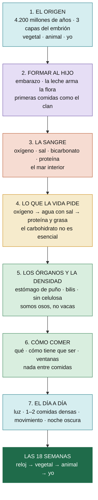

# El hilo de la vida

> **El fundamento del Sistema Nutrición Evolutiva.** Es la línea de pensamiento que explica **por qué** comemos y vivimos como proponemos. Empieza en el origen de la vida y termina en lo que hacés mañana a la mañana. Cada capítulo se apoya en el anterior: si entendés cómo se forma un cuerpo, entendés qué necesita.
>
>
## El recorrido

## Los capítulos
1. [[Capítulo 1 - El origen]]: cómo se forma un cuerpo, las tres capas del embrión y los tres cuerpos.
2. [[Capítulo 2 - Formar al hijo]]: antes de concebir, el embarazo, la leche que arma la flora y las primeras comidas.
3. [[Capítulo 3 - La sangre]]: el mar interior; lo que dice la sangre sobre cómo alimentarnos.
4. [[Capítulo 4 - Lo que la vida pide]]: la jerarquía de lo que el cuerpo necesita para las funciones vitales.
5. [[Capítulo 5 - Los órganos y la densidad]]: por qué nuestra biología está hecha para comida densa; la comparación con otros animales.
6. [[Capítulo 6 - Cómo comer]]: qué comer, cómo tiene que ser, qué genera en nosotros, cuándo y cómo.
7. [[Capítulo 7 - El día a día]]: el protocolo bajado a un día real, conectado con las 18 semanas.

## La idea en una frase por capítulo
| Cap. | La idea | Quién lo enseña |
|---|---|---|
| 1 | El cuerpo repite en 9 meses 4.200 millones de años de evolución: ese saber es el médico (Tabiat) | Duarte |
| 2 | La salud de un hijo se decide antes de nacer; la leche no es para nutrir, es para armar la flora | Duarte, Nutrillermo |
| 3 | La sangre es oxígeno, sal, bicarbonato y proteína: así nos tenemos que alimentar | Sanagustín, Duarte |
| 4 | Primero respirar, después agua con sal, después proteína y grasa; el azúcar no es esencial | Duarte |
| 5 | Estómago de puño, vesícula grande, sin cuatro estómagos: somos osos, no vacas | Duarte, Juan Bola, Sanagustín |
| 6 | Poco, denso, de día, con grasa y vivo; nada de picar | Todos |
| 7 | Luz, sal, una o dos comidas densas, movimiento, noche oscura | Todos |

Mapa visual: `Mapas/1 General/El hilo de la vida.canvas`.
